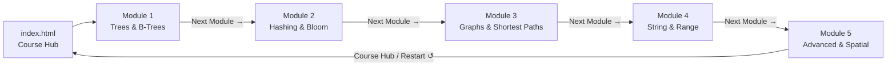

# Interactive Data Structures & Algorithms Lab Suite

An interconnected, browser-executable suite of 5 deep-dive interactive computer science labs covering foundational to advanced data structures and algorithms. Zero dependencies, fully offline-capable, responsive, and accessible.

---

## 🗺️ Curriculum Progression

Navigate sequentially through all 5 modules using the **Next Module &rarr;** redirection buttons:

---

## 📚 Module Overview

### 🏠 [`index.html`](index.html) — Course Hub
- Visual roadmap and quick-stepper strip.
- Direct cards linking to each module with overview, tag badges, and feature highlights.

### 🌳 [`Module 1 Tree Lab.html`](Module%201%20Tree%20Lab.html) — Step 1: Trees & B-Trees
- **Binary Search Tree (BST)**: Insertion, deletion with successor replacement, in-order verification.
- **AVL Tree**: Self-balancing invariants, LL/RR single rotations, LR/RL double rotations.
- **Splay Tree**: Self-adjusting trees via Zig, Zig-Zig, and Zig-Zag operations (amortized $O(\log n)$).
- **B-Tree & B+ Tree**: Multi-way search trees, node splitting, key borrowing, linked leaf range traversal.
- Side-by-side time/space complexity matrix.

### 🔑 [`Module 2 Hashing Lab.html`](Module%202%20Hashing%20Lab.html) — Step 2: Hashing & Bloom Filters
- **Hash Table Fundamentals**: Division and multiplication methods, load factor $\alpha = n/m$.
- **Collision Resolution**: Separate chaining vs. open addressing (linear probing, quadratic probing, double hashing) with tombstone deletion ($\unicode{x26B0}$).
- **Cuckoo Hashing**: 2-table hashing with guaranteed $O(1)$ search and recursive kick-out evictions.
- **Bloom Filters**: Compact probabilistic bit-array with $k$ independent hash functions (zero false negatives).
- Side-by-side collision resolution & trade-off table.

### 🕸️ [`Module 3 Graph Lab.html`](Module%203%20Graph%20Lab.html) — Step 3: Graphs & Shortest Paths
- **Graph Representations**: Adjacency list vs. adjacency matrix with real-time degree calculation.
- **Breadth-First Search (BFS) & Depth-First Search (DFS)**: Step-by-step traversal, frontier queues/stacks, discovery order, cycle detection.
- **Kruskal's Minimum Spanning Tree (MST)**: Greedy edge selection with Disjoint Set Union (DSU / Union-Find) and path compression.
- **Shortest Paths**: Dijkstra's algorithm (non-negative weights) and Floyd-Warshall dynamic programming (all-pairs $O(V^3)$ with negative weight support).
- Side-by-side graph algorithm comparison matrix.

### 🔤 [`Module 4 String & Range Lab.html`](Module%204%20String%20&%20Range%20Lab.html) — Step 4: String & Range Structures
- **Trie & Compressed Trie (Radix Tree)**: Prefix tree lookups, auto-complete, and path compression.
- **Suffix Arrays & LCP Arrays**: Sorted suffixes, longest common prefix arrays, substring binary search.
- **String Indexing Structures**: Knuth-Morris-Pratt (KMP $\pi$-table) and Aho-Corasick multi-pattern automaton with failure links.
- **Segment Trees**: Range queries (sum/min) and point updates in $O(\log n)$ with tree layout visualization.
- Side-by-side string & range structure matrix.

### 🌐 [`Module 5 Advanced & Spatial Lab.html`](Module%205%20Advanced%20&%20Spatial%20Lab.html) — Step 5: Advanced & Spatial Structures
- **Skip Lists**: Multi-level probabilistic linked hierarchy with coin-flip tower promotion ($O(\log n)$ search).
- **Persistent Trees**: Immutable versioned trees using path copying; time travel through tree versions without copying untouched subtrees.
- **KD-Trees**: 2D spatial partitioning with alternating axis splits ($X \rightarrow Y$), rectangular bounding box subdivisions, and nearest neighbor (k-NN) pruning.
- **Spatial Grids & Concurrent Structures**: Quadtree 4-quadrant decomposition and lock-free atomic stack using Compare-And-Swap (CAS).
- Comprehensive comparison matrix.

---

## 📝 University & Interview Exam Q&A Bank (2M, 4M, 6M)

Every topic across all 5 modules includes an interactive **Exam & Technical Interview revision component** on the concept sidebar:
- **2 Marks (Short Answers)**: Definitions, core formulas, balance factors, constraints, and time/space complexity bounds.
- **4 Marks (Medium Explanations)**: Step-by-step algorithms, structural rotation diagrams, comparison matrices, and worked trace examples.
- **6 Marks (Long Analytical Answers)**: Comprehensive proofs, amortized analysis, edge cases, kernel/production implementations, and architectural tradeoffs.
- **Interactive Filtering**: Filter by `[All]`, `[2M]`, `[4M]`, or `[6M]` with single-click accordions.

---

## 🚀 Running Locally

All modules are completely self-contained in standalone HTML/CSS/JS files:
1. Clone or download this repository.
2. Double-click `index.html` or open any `.html` file directly in any modern web browser.
3. No build tools, Node.js runtime, or npm installs required!
